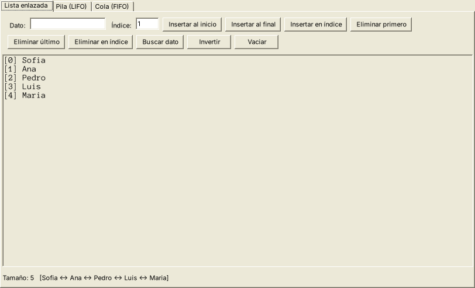
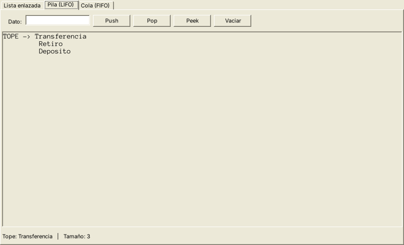
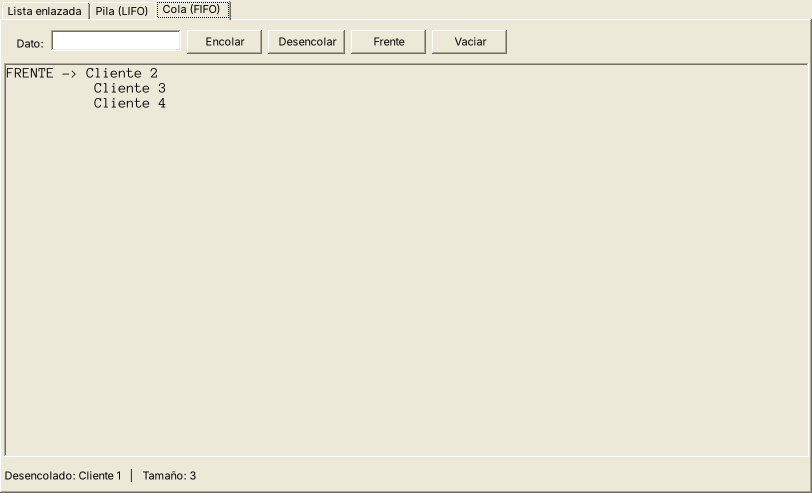
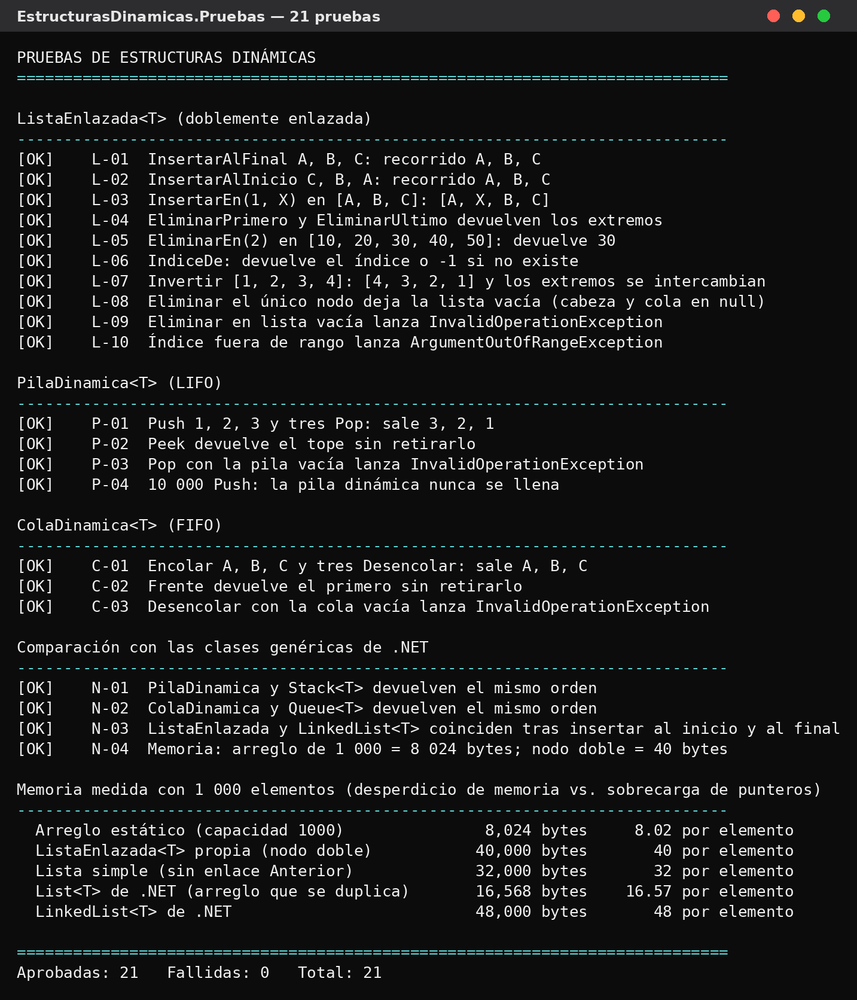

# Tarea 3.2 – Implementación dinámica y comparativa (Listas, Pilas y Colas)

**Alumna:** Barbara Sofia Montalvo Ontiveros · **Matrícula:** I25050373
**Asignatura:** Estructuras de Datos · **Docente:** Ruben Riojas
**Instituto Tecnológico Superior de Monclova** – Ingeniería en Informática
**Unidad 3:** Estructuras lineales

🎥 **Video explicativo:** https://youtu.be/lriWJ04O5wE

---

## 1. Descripción

Aplicación de **Windows Forms en C# (.NET 8)** con estructuras lineales **dinámicas** implementadas desde cero con nodos enlazados y genéricos (`<T>`):

| Clase | Descripción |
|---|---|
| `Nodo<T>` | Nodo con el dato y las referencias `Siguiente` y `Anterior`. |
| `ListaEnlazada<T>` | Lista **doblemente enlazada** con referencias a cabeza y cola. Inserta, elimina, busca, invierte y se recorre con `foreach`. |
| `PilaDinamica<T>` | Pila LIFO sobre la lista (el tope es la cabeza). `Push`, `Pop`, `Peek`. |
| `ColaDinamica<T>` | Cola FIFO sobre la lista (se encola al final y se desencola por el frente). |
| `FormEstructurasDinamicas` | Formulario con una pestaña para probar cada estructura. |

Se eligió una lista doblemente enlazada con referencia a la cola para que insertar y eliminar en **ambos extremos** sea O(1). La pila y la cola reutilizan la lista por **composición**.

## 2. Complejidad

| Operación | Lista enlazada | Pila | Cola |
|---|---|---|---|
| Insertar / eliminar al inicio | O(1) | `Push` / `Pop` O(1) | `Desencolar` O(1) |
| Insertar / eliminar al final | O(1) | — | `Encolar` O(1) |
| Insertar / eliminar en un índice | O(n) | — | — |
| Buscar | O(n) | — | — |
| Consultar el extremo | O(1) | `Peek` O(1) | `Frente` O(1) |

## 3. Estructura del proyecto

```
EstructurasDinamicas/
├── EstructurasDinamicas.sln
├── EstructurasDinamicas/              Aplicación Windows Forms
│   ├── Nodo.cs
│   ├── ListaEnlazada.cs
│   ├── PilaDinamica.cs
│   ├── ColaDinamica.cs
│   ├── FormEstructurasDinamicas.cs
│   └── Program.cs
├── EstructurasDinamicas.Pruebas/      21 pruebas automáticas y medición de memoria
└── docs/capturas/
```

## 4. Cómo ejecutar

Requisitos: Visual Studio 2022 con la carga de trabajo **Desarrollo de escritorio de .NET** (SDK de .NET 8).

1. Abrir `EstructurasDinamicas.sln`.
2. **Aplicación:** clic derecho en `EstructurasDinamicas` → *Establecer como proyecto de inicio* → `F5`.
3. **Pruebas:** clic derecho en `EstructurasDinamicas.Pruebas` → *Establecer como proyecto de inicio* → `Ctrl + F5`.

## 5. Pruebas

Resultado: **21 aprobadas, 0 fallidas**.

| Grupo | Casos |
|---|---|
| Lista enlazada (L-01 a L-10) | Insertar al inicio, al final y en índice; eliminar extremos y en índice; buscar; invertir (comprobando los enlaces en ambos sentidos); eliminar el único nodo; lista vacía; índice fuera de rango |
| Pila (P-01 a P-04) | Orden LIFO, `Peek` sin retirar, `Pop` en pila vacía, 10 000 `Push` sin llenarse |
| Cola (C-01 a C-03) | Orden FIFO, `Frente` sin retirar, `Desencolar` en cola vacía |
| Clases de .NET (N-01 a N-04) | Mismo orden que `Stack<T>`, `Queue<T>` y `LinkedList<T>`; memoria del arreglo y del nodo |

## 6. Estático vs. dinámico: memoria medida

El proyecto de pruebas mide la memoria que realmente reserva cada estructura con 1 000 elementos (.NET 8, 64 bits):

| Estructura | Bytes | Bytes por elemento |
|---|---|---|
| Arreglo estático (capacidad 1 000) | 8 024 | — |
| `ListaEnlazada<T>` propia (nodo doble) | 40 000 | 40 |
| Lista simple (sin enlace `Anterior`) | 32 000 | 32 |
| `List<T>` de .NET | 16 568 | 16.57 |
| `LinkedList<T>` de .NET | 48 000 | 48 |

El arreglo **desperdicia memoria** si está poco ocupado (reserva las 1 000 posiciones siempre); la lista **paga 32 bytes de punteros y encabezado** por cada dato. La lista es más ligera mientras use menos del 20 % de la capacidad del arreglo.

## 7. Capturas

| Lista enlazada | Pila (LIFO) | Cola (FIFO) |
|---|---|---|
|  |  |  |


